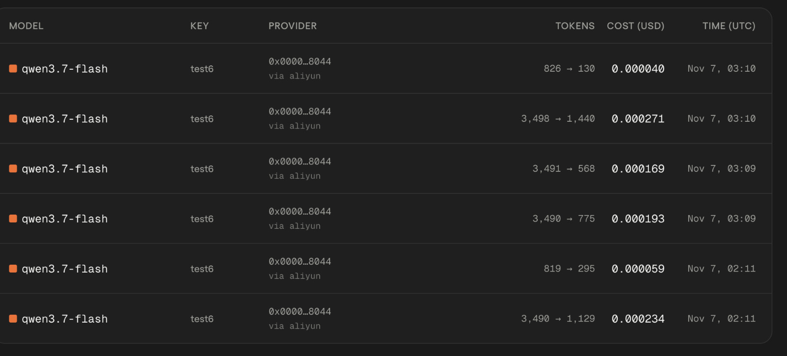
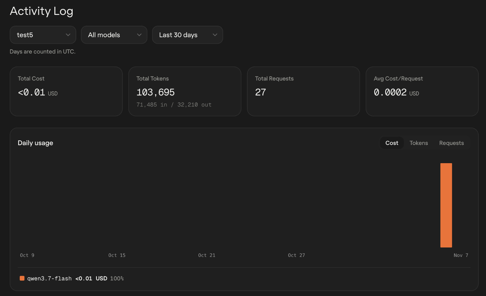

# Poros — 0G

**Track:** Build with 0G Private Computer

The inference integration is implemented, with team-supplied usage screenshots below. A real request ID, its strategy input/result, and the demo link remain to be attached. [Team contacts](../SUBMISSION.md#team) are recorded.

[Live app](https://poros-theta.vercel.app/) · [Repository](https://github.com/ArshadullaShaik/Poros) · [Setup](../README.md#run-locally) · [Requirements](https://ethglobal.com/events/mumbai/prizes/0g)

## What we built

Poros helps trading communities turn written ideas into rules they can inspect and test. A user brings in a creator's strategy, opens it in the builder, and uses 0G inference to translate the text into price conditions, risk checks, and buy or sell actions.

We check the result with the builder's validator before loading it onto the canvas for review. The user can then change the rules or test them with virtual funds. Interpretation itself never places a trade.

0G handles the translation from written instructions to structured rules. Without it, users can still build strategies by dragging blocks onto the canvas, but they have to translate the text themselves.

The interpreter is limited to registered markets, inclusive USD price ranges or explicitly requested market-price behavior, and specified trade amounts within the current $20 order cap. It is instructed to ask for clarification when a strategy is ambiguous or unsupported. Those questions are returned to the user without a proposed graph.

## How we use 0G

| Detail | Implementation |
|---|---|
| Catalog | `GET https://router-api.0g.ai/v1/models` |
| Inference | `POST https://router-api.0g.ai/v1/chat/completions` |
| Model selection | We choose the lowest estimated-cost eligible `qwen3.7-flash` or `qwen-flash` model. It must have pricing, an available provider, text input/output, OpenAI format, tool support, and enough context. |
| Cost controls | Price caps come from the catalog. Providers are selected by price, fallback is disabled, and output is capped at 2,048 tokens. The estimate is not a billing quote. |
| Request details | We return the model and latency, plus `x_0g_trace.request_id`, provider, and billing metadata when 0G supplies them. |
| Error handling | Malformed output and model mismatches are rejected. Authentication, balance, rate-limit, and provider errors are reported to the user. Requests time out after 30 seconds without an automatic paid retry. |

Users provide their own inference key. It is saved in browser storage when available and sent to our backend for the requested inference. Since scripts on the same origin can read that storage, use a dedicated key and the **Forget key** control when finished. API keys and authorization headers should be removed from any shared request evidence.

We have not independently verified confidential-execution proofs for this integration.

## Code and tests

| Area | Source and tests |
|---|---|
| Catalog, inference, and metadata | [0G client](../src/features/builder/ai/zero-g.ts), [AI tests](../tests/dev3/ai.test.ts) |
| Text to graph | [Interpreter](../src/features/builder/ai/interpreter.ts), [flow tests](../tests/dev3/text-live-flow.test.ts) |
| Review and clarification | [Interface](../src/features/builder/demo/ai.js), [UI tests](../tests/dev3/ai-ui.test.ts) |
| API | [Handler](../src/features/builder/server/api.mjs), [route tests](../tests/dev3/ai-route.test.ts) |

The tests cover model selection, response validation, clarification, and the API and UI flows using controlled responses. They do not establish that a paid request succeeded on the deployed app.

## Submitted usage evidence

The team supplied the following 0G dashboard screenshots on 7 November 2026.

| Evidence | Visible details |
|---|---|
| Request activity | `qwen3.7-flash`, provider `0x0000…8044` via `aliyun`; six rows under key label `test6`. |
| Example row | Nov 7, 03:10 UTC; 826 input / 130 output tokens; $0.000040. |
| Usage summary | Key label `test5`; 27 requests, 103,695 tokens (71,485 input / 32,210 output), total cost below $0.01. |

These are separate dashboard views with different key labels. They show recorded model usage, but no request ID, strategy input, or reviewed canvas result.

The team reports that **0G interpretation appears at `2:35–3:15`** in the demo submitted on ETHGlobal. The shareable URL remains pending; the recording has not been independently viewed. A separate cut under three minutes is needed for the 0G submission.

## Where unused credits fit

We have also discussed an idea with 0G developers: use a person's remaining daily compute credits for agentic trading before they expire. The credits would pay for inference, with the user's permission. They would not become trading capital or authorize a trade.

The [0G Pot](../apps/web/ZERO-G-POT.md) demonstrates that idea with simulated donations and claims. It does not read real balances, transfer credits, or run inference. Real credit reuse is future work; this submission does not claim iAI sign-in, real credit deductions, or autonomous revenue-to-compute funding.

## What we still need to attach

- A successful real request ID linked to its strategy input and reviewed canvas result. Model and usage screenshots are included above; the request-level link remains pending.
- A demo lasting at least two minutes and less than three, showing the written strategy, interpretation, real request details, and canvas review.

Public team names and contacts are listed in the [submission checklist](../SUBMISSION.md#team).

The app, repository, and setup links are above. This inference path does not deploy a contract; verified contract addresses are only needed if we include other deployed contracts in the submission. The 0G demo can be recorded independently of the unfinished Definitive advanced-order work.
