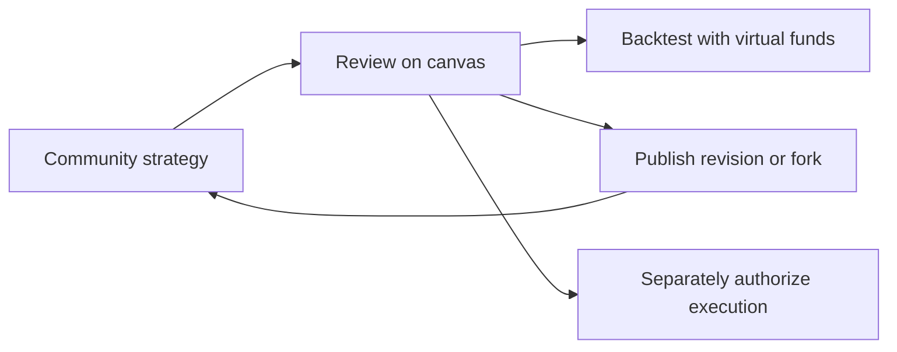

# Poros

**Build, discuss, and test trading ideas with their history attached.**

[Try Poros](https://poros-theta.vercel.app/) · [Communities](https://poros-theta.vercel.app/community) · [Repository](https://github.com/ArshadullaShaik/Poros)

A trading screenshot rarely explains the exact rules or what changed later. Poros connects community discussion to authored strategy versions that people can inspect, import, and improve.



## Explore

| Page | Purpose |
|---|---|
| [Home](https://poros-theta.vercel.app/home) | Discover public strategies and rooms. |
| [Trade](https://poros-theta.vercel.app/) | Build rules, import versions, review drafts, and backtest. |
| [Orders](https://poros-theta.vercel.app/orders) | Inspect charts and available execution history. |
| [Communities](https://poros-theta.vercel.app/community) | Discuss strategies, find creators, and manage memberships. |
| [Profile](https://poros-theta.vercel.app/profile) | Wallet-linked identity and available membership/trading records. |
| [0G Pot](https://poros-theta.vercel.app/0g-pot) | Clearly labelled mock compute-credit pool. |

Public browsing needs no wallet. Validated graphs import directly; written posts require paid AI interpretation with a user-provided key. Reading, importing, or subscribing never authorizes a trade.

Community writes use Arkiv Rabdi tGLM. New creator memberships cost a creator-set tGLM price for 30 days; free joining remains separate. Older Sepolia claims retain recovery support.

## Architecture

| Layer | Technology / responsibility |
|---|---|
| Website | Next.js, React, TypeScript, CSS; canvas and community views. |
| Public records | Arkiv Rabdi SDK; strategies, social events, memberships, and trade attestations. |
| AI | 0G inference; structured proposals for review. |
| Markets and execution | Definitive/Flash adapters and market-history readers. Current execution submits market orders. |
| Private messages | Encrypted Swarm/Bee content with authenticated backend delivery. |
| Workers | Node.js and persistent SQLite for custody, recovery, and reconciliation. |

Arkiv is not the only database. Full secret Swarm references stay in encrypted backend custody. The operator and trusted Bee can access plaintext; this is not end-to-end encryption. Public records normally last 180 days, chat 45 days; community overrides/extensions and trade-worker renewal exist.

## Run locally

Use Node.js **24+**, npm, and an injected wallet such as MetaMask for signed actions.

```sh
git clone https://github.com/ArshadullaShaik/Poros.git
cd Poros
npm --prefix src/integrations/arkiv ci --ignore-scripts
npm --prefix apps/web ci --ignore-scripts
npm --prefix apps/web run dev
```

Open `http://127.0.0.1:4325`. The launcher loads root `.env.local`. Set `ARKIV_ACCESS_KEY` from the [Arkiv Hub](https://hub.arkiv.network/access-keys) for your own query allowance; keep it out of Git. Obtain test gas from the [Rabdi faucet](https://hub.arkiv.network/faucet).

Public browsing does not require workers. Full member delivery needs a persistent backend, Bee postage, relay wallet, and custody database. See [membership setup](apps/web/README.md#encrypted-swarm-message-setup) and [trade recording](apps/web/README.md#verified-live-trade-recording-on-arkiv). Vercel alone does not run these persistent services.

## Verify the public data

The public data network is **Arkiv Rabdi**, chain ID **7794095**. You can read it independently of the Poros website through the [Rabdi Explorer](https://rabdi.explorer.arkiv.network) or the SDK.

These writer addresses were observed in a read-only Rabdi query on 7 November 2026:

| Writer | Observed records |
|---|---|
| `0xb111eBDA2DaF4C9bC2437dD6a883014A1Ecf8F45` | Public strategy version, profile, and community activity. |
| `0x218959F2DDf224370cE2e1Da1dAE5e9059414AEa` | Profile, creator plans, discussion, and direct private-signal records. |
| `0xe108faF659ACc2B86A4DDbbC2770D86e544c63ed` | A direct subscription record. |
| `0x66B9110BDA6fA6DC1ec50D1595FDf277fbAEBBd3` | A relayed private-signal publication. |

After installing the dependencies above, run this from `src/integrations/arkiv`. It only reads public data; it does not need a wallet or send a transaction. An optional `ARKIV_ACCESS_KEY` environment variable avoids relying on the shared public allowance.

```sh
node --input-type=module -e '
import {createPublicClient} from "@arkiv-network/sdk";
import {rabdi} from "@arkiv-network/sdk/chains";
import {eq, asc} from "@arkiv-network/sdk/query";
import {http} from "viem";
const client = createPublicClient({
  chain: rabdi({accessKey: process.env.ARKIV_ACCESS_KEY ?? ""}),
  transport: http()
});
const result = await client.select()
  .where(eq("arkiv.schema", "ethmumbai.strategyhub.v1.versions"))
  .orderBy(asc("$key")).limit(100).fetch();
console.table(result.entities.map(e => ({
  key: e.$key, author: e.$creator,
  name: e.$attributes.name.value,
  expiresAtBlock: String(e.$expiresAt)
})));
'
```

The checked snapshot returned **1 public strategy version**. Its key was `0xca6ffbc0c38d4d8540db184b54954aedb757f08f90885cfcbad0b551194bed60`, named **Poros shared RSI test**. Changing the namespace to `ethmumbai.social.v1.events` queries social records; that snapshot contained **21 events**, including legacy and current formats. These are development records, not adoption metrics. Counts can change, and expired records may disappear. The example reads one page; application readers paginate and validate records before trusting them.

## Checks

Build before web tests; they inspect generated Next assets.

```sh
npm --prefix src/integrations/arkiv test
npm --prefix src/integrations/arkiv run typecheck
node --test tests/dev3/*.test.ts
npm --prefix apps/web run build
npm --prefix apps/web test
```

At `6fee655`: **506 tests passed**, one funded-wallet test skipped; production build and Arkiv typecheck passed. [Verification details and limits](apps/web/VERIFICATION.md). The team separately reports successful deployment testing. Simulations and verifier-backed reports do not guarantee profit.

## Attribution and license

The team identifies Poros as a from-scratch ETHGlobal Mumbai build. Community modules were consolidated from the team's earlier development workspace; eligibility depends on the actual event timeline.

Codex assisted implementation, debugging, tests, Next.js migration, and documentation across `apps/web/`, `src/integrations/arkiv/`, builder integrations, and their tests. The team directed product and integration decisions, deployed the app, and performed wallet testing. Submission documents were drafted with AI assistance against source and observed checks. The team must confirm any other AI tools and required planning artifacts are disclosed.

[Apache-2.0](LICENSE). Dependencies and user-published strategies retain their own applicable licenses.

## Documentation

| Guide | Contents |
|---|---|
| [Runtime](apps/web/README.md) | Configuration, workers, recovery. |
| [Schema](arkiv/schema.md) | Entities, indexes, permissions, retention. |
| [Integration](arkiv/how-you-use-arkiv.md) | Public records and product behavior. |
| [Design rationale](arkiv/why-arkiv.md) | Independent access to strategy history. |
| [Audience](arkiv/reach.md) | Users and proposed next steps. |
| [Feedback](arkiv/friction.md) | Reproduced limitations and improvements. |
| [Submission checklist](SUBMISSION.md) | Readiness and outstanding evidence. |
