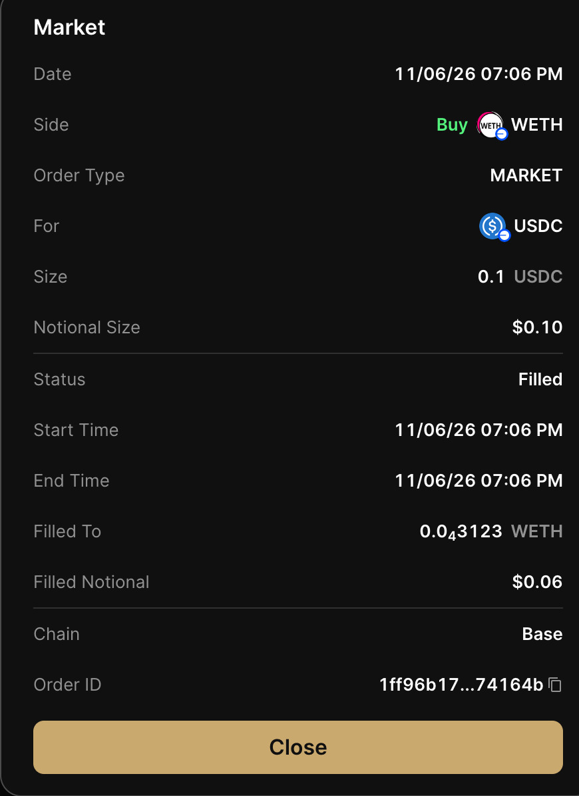
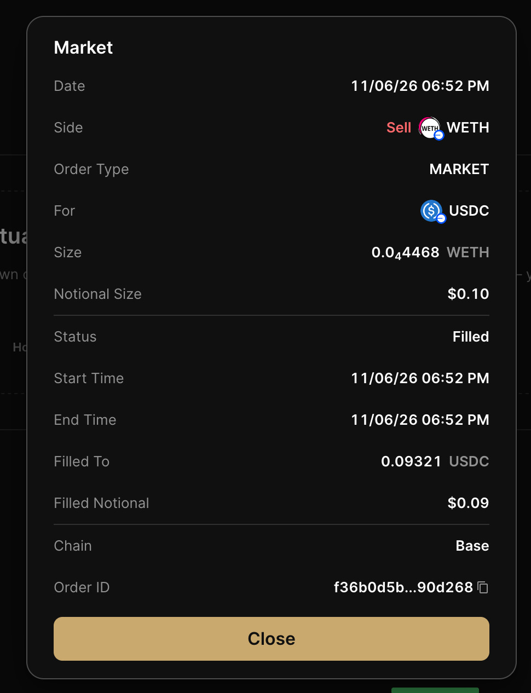

# Poros — Definitive

**Track:** Best Use of Flash Advanced Orders in a Social App

The social trading flow is implemented, but the advanced-order integration is not complete. Our current adapters submit Flash market orders.

[Live app](https://poros-theta.vercel.app/) · [Main demo](https://drive.google.com/file/d/1r3lqRVqUpi-3--zr1bCQRdSJWsFJZvdL/view?usp=drive_link) · [Repository](https://github.com/ArshadullaShaik/Poros) · [Setup](../README.md#run-locally) · [Requirements](https://ethglobal.com/events/mumbai/prizes/definitive)

## How Definitive fits into Poros

Poros connects community discussion to strategies people can review and use. Someone can discover a creator's idea, inspect the rules, and decide whether to run it. Definitive handles order submission in the live execution flow.

The current path is:

1. Find a strategy in a community or on a creator's profile.
2. Import its published graph, or interpret a written post, and review the rules on the canvas.
3. Start a live run. Poros monitors the price condition locally and checks the network, recipient, amount, quote, and signing data before submission.
4. Approve the required wallet actions. The adapter submits a Flash market order once the checks pass.
5. Follow the order's status and available execution history. Paper results are shown separately.

Reading a post, importing a strategy, or subscribing to a creator does not authorize a trade.

## What is still missing

Both adapters currently send `orderType: "market"`. Poros checks the price condition locally; it does not create a provider-managed Limit, DCA, Stop, Take Profit, or TWAP order. Unexpected order types and attached brackets are rejected.

That distinction matters for this track. We still need to implement and demonstrate a genuine Flash advanced order. The existing price-triggered market-order flow does not meet that requirement.

If a submission has an unknown outcome, we do not retry it automatically. Stopping Poros's local monitor also does not cancel an order that Flash has already accepted.

## Code and tests

| Area | Source and tests |
|---|---|
| EVM submission and signing checks | [Flash orders](../src/features/builder/execution/flash-orders.ts), [tests](../tests/dev3/flash-wallet.test.ts) |
| Solana submission | [Adapter](../src/features/builder/execution/solana-orders.ts), [tests](../tests/dev3/solana-orders.test.ts) |
| Local monitoring | [Monitor](../src/features/builder/execution/monitor.ts), [tests](../tests/dev3/price-monitor.test.ts) |
| Community handoff | [Controller](../src/features/builder/demo/community.js), [tests](../tests/dev3/text-live-flow.test.ts) |

## Submitted market-order evidence

The team supplied these screenshots on 7 November 2026. Both show **MARKET** orders marked **Filled** on **Base**.

| Field | Buy | Sell |
|---|---|---|
| Order ID | `1ff96b17-eaf6-4112-8494-6e9b8d74164b` (full ID supplied by the team) | `f36b0d5b…90d268` (only a shortened ID is visible) |
| Pair and direction | USDC → WETH | WETH → USDC |
| Displayed notional size | $0.10 | $0.10 |
| Displayed filled notional | $0.06 | $0.09 |
| Displayed time | `11/06/26 07:06 PM` | `11/06/26 06:52 PM` |

The screenshots do not specify a timezone or include transaction hashes. They document displayed market-order fills; they do not establish advanced-order qualification or independently verified onchain execution.

[Team and contacts](../SUBMISSION.md#team)

## Evidence still needed

The app is [deployed](https://poros-theta.vercel.app/), and the team reports successful deployment testing. To complete this track's evidence, we still need:

- A working Flash advanced-order flow.
- A real advanced order's ID, type, network, and final status.
- Its onchain execution and Explorer link shown in the demo. An accepted order or a paper fill is not execution evidence.
- Confirm that the [team-supplied X post](https://x.com/LakshyaSingh_02/status/2118921354322018514) contains the demo video and tags `@DefinitiveFi`. The link was supplied by the team and has not been independently reviewed.

Once the advanced-order flow is ready, the demo should follow one idea from community discovery through review, wallet approval, and execution. A recording lasting at least two minutes and less than three can also cover the shared project demo. Until then, this is a preview of the social trading product, not a completed advanced-order submission.
